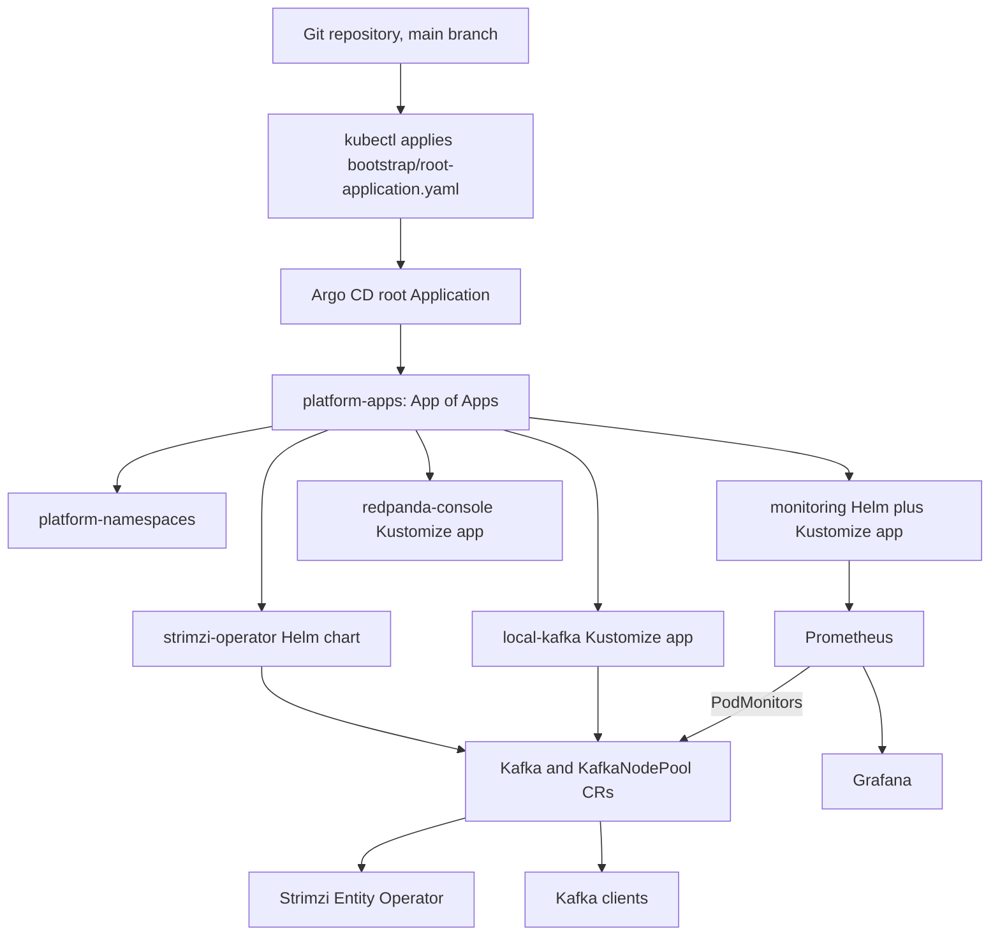
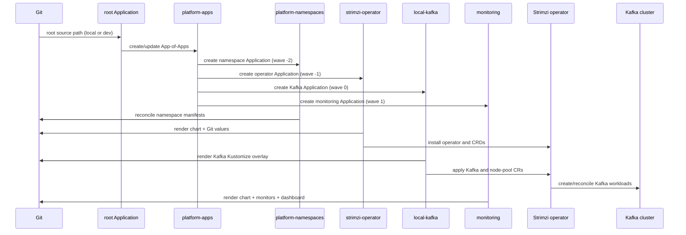
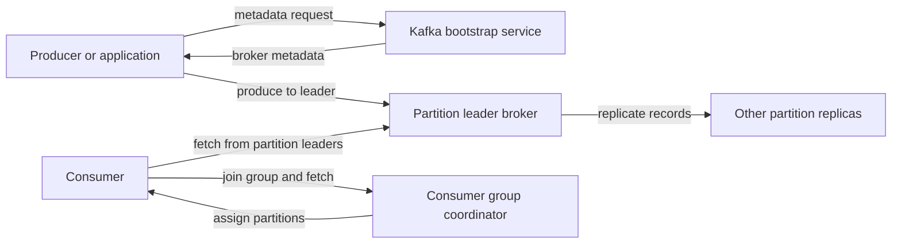

# Architecture and GitOps deployment flow

This repository deploys a Strimzi-managed Kafka cluster and supporting
monitoring to Kubernetes. Its delivery pipeline is GitOps-based: Argo CD reads
the manifests and Helm values from this Git repository and reconciles them
against the cluster. There is no CI workflow defined in this repository; local
render checks and Argo CD perform the validation and deployment described
below.

For a beginner-friendly explanation of Strimzi and the resources used by this
deployment, see [`STRIMZI-GUIDE.md`](./STRIMZI-GUIDE.md).

## At a glance



The root and App-of-Apps Applications have automated sync, pruning, and
self-healing enabled. The child Applications for namespaces, Strimzi, and Kafka
also have automated sync enabled. The monitoring Application is intentionally
different: automated sync is omitted in
[`applications/base/monitoring.yaml`](./applications/base/monitoring.yaml).
Argo CD can still render and show monitoring drift, but it does not
automatically sync that Application. Parent apps create/manage Application
objects; they do not override each child Application's own sync policy.

## Deployment pipeline

### 1. Bootstrap the cluster and Argo CD

The cluster is prepared outside the GitOps Application tree. The README's
bootstrap procedure starts Minikube, installs Argo CD into the `argocd`
namespace, and applies [`bootstrap/root-application.yaml`](./bootstrap/root-application.yaml).
That is the initial hand-off from imperative setup to GitOps. Argo CD must be
able to read the Git repository; for a private repository, repository
credentials are installed as a Kubernetes Secret outside Git.

### 2. Root Application loads the selected environment

The root Application reads `argocd/overlays/local` by default. That overlay
loads the App-of-Apps resource at
[`argocd/base/app-of-apps.yaml`](./argocd/base/app-of-apps.yaml). The
App-of-Apps Application is named `platform-apps` and reads
`applications/overlays/local`.

The overlays select an environment by patching Application sources and Helm
values:

| Environment | Root path | Child Application path | Environment differences |
|---|---|---|---|
| Local (default) | `argocd/overlays/local` | `applications/overlays/local` | Local values; Kafka adds a TLS NodePort listener |
| Dev (opt-in) | `argocd/overlays/dev` | `applications/overlays/dev` | Dev-specific values; Kafka has no local NodePort listener |

The root defaults to local; switching to dev requires changing its source path
to `argocd/overlays/dev` before applying the root manifest. There is no
production overlay in the repository.

### 3. App-of-Apps creates the child Applications

[`applications/base/kustomization.yaml`](./applications/base/kustomization.yaml)
includes Applications for namespaces, Strimzi, Kafka, Redpanda Console, and
monitoring. The environment overlay changes their Kustomize paths or adds
environment-specific Helm values. The `sync-wave` annotations on these
Application objects express the intended ordering: namespaces (`-2`), Strimzi
(`-1`), Kafka (`0`), then monitoring and Redpanda Console (`1`). Strimzi and
Kafka Applications also have retry/backoff configured because Kafka custom
resources depend on Strimzi CRDs being installed.

The child Applications source different kinds of content:

| Application | Source | Destination | What it manages |
|---|---|---|---|
| `platform-namespaces` | `platform/namespaces/...` | Kubernetes default namespace | `kafka`, `strimzi-system`, and `monitoring` Namespace resources |
| `strimzi-operator` | Strimzi Helm chart plus Git-hosted values | `strimzi-system` | Strimzi operator and its supporting resources |
| `local-kafka` | `platform/kafka/...` Kustomize overlay | `kafka` | Kafka, KafkaNodePool, KafkaTopic, and KafkaUser custom resources |
| `redpanda-console` | `platform/redpanda-console/base` | `kafka` | Read-only topic explorer connected to Strimzi Kafka using a dedicated SCRAM user |
| `monitoring` | kube-prometheus-stack Helm chart plus Git-hosted values and monitors | `monitoring` | Prometheus, Grafana, and monitoring configuration |

The local overlay adds values for the Strimzi and monitoring charts and adds
the Kafka listener patch. The chart versions and base values are pinned in the
Application and `infrastructure` manifests.

### 4. Reconciliation and change delivery

For Applications with automated sync, a commit pushed to the tracked `main`
branch causes Argo CD to fetch and render the source (Helm or Kustomize), compare
the rendered desired state with the live cluster, and apply differences.
Pruning removes resources deleted from Git, while self-healing reapplies the
desired state if managed resources are changed manually. In contrast,
monitoring changes are rendered and reported but require an explicit sync while
its automated policy remains disabled.

Useful local render checks, run from the repository root, are:

```bash
kubectl kustomize argocd/overlays/local
kubectl kustomize applications/overlays/local
kubectl kustomize platform/namespaces/overlays/local
kubectl kustomize platform/kafka/overlays/local
kubectl kustomize platform/monitoring/overlays/local
```

These render Kustomize sources only. Argo CD renders the Helm sources using its
bundled Helm renderer.

### Namespaces, ownership, and reconcile ordering

The platform separates control-plane resources from workloads:

| Namespace | Main contents | Owner |
|---|---|---|
| `argocd` | Argo CD and the `root`, `platform-apps`, and child Application CRs | Argo CD installation plus the root/App-of-Apps chain |
| `strimzi-system` | Strimzi Cluster Operator | `strimzi-operator` Application |
| `kafka` | Kafka cluster, node pool, Topic/User custom resources, and generated Kafka pods, services, PVCs, and secrets | `local-kafka` Application and Strimzi |
| `monitoring` | Prometheus Operator stack, Grafana, PodMonitors, dashboard ConfigMap | `monitoring` Application |
| `kube-system` | Prometheus Node Exporter DaemonSet | kube-prometheus-stack chart |

The namespace Application creates `kafka`, `strimzi-system`, and `monitoring`
with Pod Security Admission enforcement set to `baseline` and audit/warn set
to `restricted`. Node Exporter is placed in `kube-system` because it needs
host-level access for node metrics. Namespace creation is also enabled as a
sync option on several Applications; the Namespace Application supplies the
labels and security settings.

Argo CD manages chart-rendered objects and the custom resources. Strimzi, in
turn, manages Kafka's generated pods, Services, PVCs, certificates, and
entity-operator resources. Generated resources are outputs of the Kafka custom
resources: edit the CRs in Git rather than editing Strimzi-managed workloads.

The intended child-Application order is:



Waves on child Application objects communicate the intended order when the
parent syncs. They do not prove that a child Application's pods or CRDs are
ready before another child starts operating. Strimzi and Kafka Applications
have retries/backoff to cope with this eventual consistency. During bootstrap,
check Application health and CRD readiness rather than assuming a wave is a
readiness gate.

The root and parent Applications have automated sync, pruning, and
self-healing. The namespaces, Strimzi, and Kafka child Applications also
automatically sync. Monitoring is deliberately manual-sync: commits update
its desired state and Argo CD can show it as `OutOfSync`, but an operator must
explicitly sync that Application for its Kubernetes resources to change. Its
Application object remains managed by `platform-apps`; disabling the child's
auto-sync does not remove it or stop already-running monitoring pods.

## Strimzi and Kafka architecture

### Operator and custom resources

The Strimzi Helm chart installs the cluster operator in `strimzi-system`.
[`infrastructure/strimzi/values.yaml`](./infrastructure/strimzi/values.yaml)
configures one operator replica and limits its watch scope to the `kafka`
namespace. The operator watches Kafka custom resources there and reconciles
them into Kafka pods, Services, storage claims, configuration, and certificates.
The operator is a control-plane component; Kafka brokers/controllers run in
`kafka`. The local operator values set a full reconciliation interval of
120,000 ms and operation timeout of 300,000 ms. The base chart values request
100 millicores and 256 MiB for the operator and cap it at 500 millicores and
512 MiB.

Kafka's desired state is split across these resources in
[`platform/kafka/base`](./platform/kafka/base):

- `Kafka` named `local-kafka`: Kafka version `4.3.1`, KRaft enabled, internal
  listener, authorization, replication settings, and metrics configuration.
- `KafkaNodePool` named `local`: three replicas, each with both `broker` and
  `controller` roles.
- `KafkaTopic` named `demo-events`: three partitions and replication factor
  three.
- `KafkaUser` named `app-user`: SCRAM-SHA-512 authentication, topic ACLs for
  `demo-events` and `test-topic`, and a consumer-group ACL for `kafka-http-demo`.

The `Kafka` and `KafkaNodePool` resources use Strimzi's node-pool and KRaft
features. There is no ZooKeeper cluster. All three Kafka pods combine the
controller and broker roles, which is suitable for this small lab but not the
recommended production separation of controller and broker pools.

### Data, availability, and security

Each node-pool replica receives one 5 Gi persistent claim, with
`deleteClaim: false`; deleting the Kafka resource therefore does not request
automatic deletion of these claims. The Kafka pods request 768 MiB and have a
1536 MiB memory limit. The JVM heap maximum is 512 MiB, leaving memory for
native allocations and the filesystem page cache.

The cluster sets default topic replication to three and minimum in-sync
replicas to two. The example topic also has three replicas and three
partitions. These settings tolerate one unavailable replica for writes that
require the minimum ISR, but the three pods are on one Minikube node and one
failure domain. This is not infrastructure-level high availability.

### Kafka control plane and data plane

The operators have separate responsibilities:

1. **Argo CD** reconciles the YAML objects in Git. For the Kafka Application,
   those are the Kafka, KafkaNodePool, KafkaTopic, and KafkaUser custom
   resources.
2. **Strimzi Cluster Operator** watches the Kafka and node-pool resources,
   builds the desired Kafka deployment, and keeps generated Kubernetes
   resources aligned with those CRs.
3. **Kafka's KRaft controllers** maintain cluster metadata and broker
   assignments. There are three controller-role processes because all three
   node-pool members also have the controller role.
4. **Kafka brokers** accept client connections, store partition replicas, and
   serve produce/fetch requests. In this topology each controller is also a
   broker.
5. **Topic and User Operators** in the Entity Operator reconcile KafkaTopic
   and KafkaUser resources after the cluster is available.

The intended producer/consumer path is:



The bootstrap endpoint is only the initial contact point. Kafka returns broker
addresses in metadata; clients must be able to reach the advertised address
for every broker they need, not just the bootstrap service. For in-cluster
clients, the README uses `local-kafka-kafka-bootstrap:9092`. For local-overlay
external clients, Strimzi creates TLS NodePort listener services and reports
the bootstrap endpoint and broker endpoints in Kafka status. The Dev overlay
does not add this external listener.

Kafka writes are partitioned by key (or by the producer's partitioning policy)
and each partition has a leader plus replicas. The example topic has three
partitions and three replicas. The configured minimum ISR of two means a write
that requires all acknowledgements can continue with one replica unavailable;
the application must request `acks=all` to make that producer-side durability
condition explicit. With two unavailable replicas, the three-member KRaft
controller quorum also loses its majority, so the cluster cannot continue
normal metadata operations.

The internal listener uses SCRAM-SHA-512 over SASL_PLAINTEXT on port `9092`,
intended for authenticated in-cluster clients. Only the local overlay adds an
external TLS NodePort listener on port `9094`; clients must use the bootstrap
address and broker endpoints advertised by Kafka's status. Strimzi manages
listener certificates. The SCRAM password for `app-user` is kept in the
Kubernetes Secret generated by Strimzi and should be treated as sensitive.
The Kafka HTTP demo uses this Secret and has topic and consumer-group ACLs.
The manifests alone do not provide a complete network policy boundary between
namespaces.

Other cluster-level settings include:

| Setting | Configured value | Effect |
|---|---|---|
| Kafka version | `4.3.1` | Broker version requested by the Kafka CR |
| KRaft metadata version | `4.3-IV0` | Metadata format requested by the Kafka CR |
| Default topic replication | `3` | New topics default to three replicas |
| Minimum in-sync replicas | `2` | Replicated writes needing the configured minimum ISR require two available replicas |
| Internal offsets replication | `3` | Replication factor for consumer-offsets topic |
| Transaction state replication | `3` | Replication factor for transaction-state topic |
| Auto topic creation | Disabled | Topics should be declared explicitly |
| JVM heap | 256 MiB initial, 512 MiB maximum | Heap is only part of each pod's memory use |
| Persistent storage | One 5 Gi claim per node-pool member | Three claims total; claims are not deleted with the Kafka resource |

The topic `demo-events` overrides topic defaults with three partitions,
replication factor three, `min.insync.replicas: 2`, a 24-hour retention period,
and 1 GiB log segments. The configured retention period is a time limit, not a
guarantee that a fixed amount of disk will be used; monitor the PVCs as data
volume grows.

### Topic and user reconciliation

The Entity Operator runs the Topic Operator and User Operator alongside the
Kafka deployment. They reconcile the `KafkaTopic` and `KafkaUser` objects into
broker topics and user credentials/ACLs. This keeps those entities declarative
and version-controlled without managing broker pods directly.

When changing a topic or user, update the matching CR in Git and check its
`Ready` condition after the operator reconciles it. The User Operator creates
the Secret named after the `KafkaUser`; treat its credentials as sensitive.

Redpanda Console is deployed as a separate UI, not as a Redpanda broker.
Its `topic-explorer` KafkaUser has read-only ACLs for listing and consuming
topics, and its generated password is injected from a Kubernetes Secret. The
Console Service is ClusterIP-only and intended for local port-forward access.
An Nginx sidecar applies Basic Auth using an htpasswd file supplied through a
separate Kubernetes Secret; neither login credentials nor hashes belong in
Git. Console listens on the pod's loopback interface so the Service can only
reach it through the authenticated proxy.

### Monitoring and telemetry flow

The monitoring Application combines two Argo CD sources: the
`kube-prometheus-stack` Helm chart and repository-hosted configuration
(environment values, PodMonitors, and a generated dashboard ConfigMap).
Prometheus and Grafana are deployed to `monitoring`; the chart also runs
Node Exporter in `kube-system`.

The intended metrics path is:

1. Kafka exposes Strimzi metrics through the Kafka pods' metrics port because
   `metricsConfig.type` is `strimziMetricsReporter`.
2. The Strimzi operator exposes its own metrics endpoint.
3. `strimzi-kafka` and `strimzi-cluster-operator` PodMonitors select those pods
   and request `/metrics` every 30 seconds. Both monitors carry
   `release: monitoring`.
4. Prometheus selects PodMonitors with that release label across namespaces
   and scrapes the selected endpoints.
5. Grafana's dashboard sidecar watches for ConfigMaps labeled
   `grafana_dashboard: "1"`; Kustomize generates the Kafka overview dashboard
   ConfigMap with that label.

The Helm values configure one Prometheus replica, 30-second scrape and
evaluation intervals, ephemeral storage, and 24-hour retention (also capped at
1 GiB). This is intentionally non-durable observability data. Alertmanager is
disabled. Prometheus and Grafana Services are `ClusterIP`; accessing Grafana
from the workstation requires port-forwarding or another explicitly configured
access path.

### Failure modes and recovery boundaries

| Failure or symptom | What it affects | First checks |
|---|---|---|
| Git inaccessible or wrong branch/path | Root or child source cannot render | Repository Secret URL, credentials, `targetRevision`, and Application source path |
| Strimzi CRD missing when Kafka sync begins | Kafka custom resources cannot be applied | Strimzi Application health, operator rollout, and installed CRDs; allow configured retry |
| One Kafka pod unavailable | One replica/controller unavailable; replicated data may remain available | Pod events, node capacity, PVC status, Kafka and node-pool conditions |
| Two Kafka pods unavailable | Three-member controller quorum lacks a majority; replica ISR may fall below two | Restore node capacity and pod/PVC health; do not delete data claims as a first response |
| PVC pending | Broker cannot obtain its persistent storage | StorageClass, provisioner, PVC events, and Minikube disk |
| External bootstrap connects but broker requests fail | Advertised per-broker endpoints are not reachable from the client | Kafka listener status, NodePort Services, Minikube IP/routing, and client network access |
| Monitoring drift remains | Monitoring auto-sync is disabled | Review the diff, then explicitly sync the monitoring Application if desired |

Kafka resource failures should be diagnosed through the custom resources and
operator logs before changing generated resources. PVC deletion is destructive:
`deleteClaim: false` avoids deletion as part of normal Kafka resource removal,
but operators can still be explicitly asked to delete claims and the underlying
storage can be lost with the Minikube node.

## Operational boundaries

- Edit Kafka custom resources and values in Git; do not make durable changes
  directly to Strimzi-managed pods or generated resources.
- A disabled monitoring auto-sync policy does not stop existing monitoring
  workloads. It only prevents automatic application of desired-state changes.
- Keep the generated `app-user` and Grafana administrator Secrets out of Git;
  Kubernetes Secret values still need appropriate cluster access controls.
- Persistent Kafka data lives in PVCs. Removing a PVC is destructive and is
  not part of routine reconciliation.
- The combined-role, single-node Minikube topology is for development and
  learning. Production requires separate broker/controller pools, multiple
  failure domains, production-grade storage and networking, and managed
  secrets and policies.

## Routine inspection commands

Run these from a workstation whose `kubectl` context targets the intended
cluster:

```bash
# See Applications and distinguish their namespace from their workload namespace.
kubectl get applications.argoproj.io -A \
  -o custom-columns='APP:.metadata.name,APP-NAMESPACE:.metadata.namespace,DESTINATION:.spec.destination.namespace'

# Check Argo CD state and the Strimzi control plane.
kubectl -n argocd get applications
kubectl -n strimzi-system get deployment,pods
kubectl get crd kafkas.kafka.strimzi.io kafkanodepools.kafka.strimzi.io \
  kafkatopics.kafka.strimzi.io kafkausers.kafka.strimzi.io

# Check Kafka desired state, generated workloads and persistent claims.
kubectl -n kafka get kafka,kafkanodepool,kafkatopic,kafkauser
kubectl -n kafka get pods,pvc,svc
kubectl -n kafka describe kafka local-kafka

# Check metrics discovery and monitoring workloads.
kubectl -n monitoring get pods,svc,podmonitor,prometheus
kubectl -n kube-system get daemonset,pods \
  -l app.kubernetes.io/name=prometheus-node-exporter
```

For application-level validation, also test that a client can authenticate (if
configured), produce to and consume from the intended topic, and reach all
broker endpoints advertised by metadata. Kubernetes `Ready` status alone does
not verify client credentials, ACL correctness, application-level message
delivery, or external network reachability.
