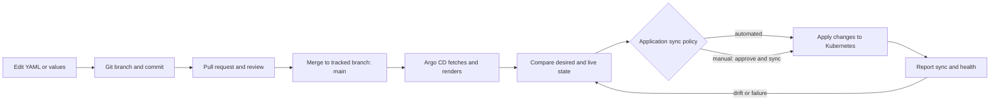

# GitOps operations and Git workflow

This guide explains how changes flow from Git into this Kubernetes cluster,
how to make and review changes safely, and where to look when reconciliation
does not behave as expected. It describes the repository as it exists today;
it is a learning lab, not a complete production operating model.

For Helm and Kustomize rendering concepts and commands, see
[`HELM-KUSTOMIZE-GUIDE.md`](./HELM-KUSTOMIZE-GUIDE.md). For Kafka-specific
architecture and operations, see [`ARCHITECTURE.md`](./ARCHITECTURE.md).

## What GitOps means here

Git is the reviewed, versioned source of desired state. Argo CD runs in the
cluster, reads the configured Git revision and path, renders the manifests,
compares them with live Kubernetes objects, and reconciles the differences
according to each Application's sync policy.



Git records intent and history. It does not itself deploy anything. In this
repository there is no CI workflow; local render checks, pull-request review,
and Argo CD provide the validation and delivery path. Argo CD health and sync
status also do not replace application-level testing, Kafka backup/recovery,
or production change controls.

## How this repository is wired

The root Application is the entry point:

1. `bootstrap/root-application.yaml` points to
   `argocd/overlays/local` on branch `main`.
2. That Kustomize overlay includes `argocd/base/app-of-apps.yaml`, defining the
   `platform-apps` Application.
3. `platform-apps` reads `applications/overlays/local`, which includes the
   shared child Application definitions from `applications/base` and applies
   local-specific patches.
4. The child Applications read their own sources:

   | Application | Git/chart source | Managed content |
   |---|---|---|
   | `platform-namespaces` | `platform/namespaces/overlays/local` | Namespace resources and labels |
   | `strimzi-operator` | Strimzi Helm chart plus `infrastructure/strimzi` values | Strimzi operator |
   | `local-kafka` | `platform/kafka/overlays/local` | Kafka, KafkaNodePool, KafkaTopic, KafkaUser custom resources |
   | `monitoring` | kube-prometheus-stack Helm chart plus Git values and `platform/monitoring` | Prometheus, Grafana, PodMonitors, dashboard configuration |
   | `kagent-workloads` | `platform/kagent/base` | Ollama model/egress configuration, Harness, and Kafka/Kubernetes agents |

The overlays under `applications/overlays/local` and `applications/overlays/dev`
select paths and add environment-specific Helm values. The Kafka local overlay
adds a TLS NodePort listener; dev reuses the common Kafka base without this
listener. The root currently selects local. There is no production overlay.

Expected ordering is expressed with sync waves: namespaces `-2`, Strimzi `-1`,
Kafka `0`, monitoring and Redpanda Console `1`, and kagent workloads `2`. A
wave orders resources during a parent sync; it is not a guarantee that a child
Application's pods or CRDs are ready before another child reconciles.
`kagent-workloads` also depends on the separately installed kagent CRDs and
controller; its Application retries until those prerequisites are available.
Retry/backoff and checking actual health/readiness remain important. See
[`KAGENT-GUIDE.md`](./KAGENT-GUIDE.md) for the kagent installation procedure.

### Who owns what?

- **Argo CD** owns the declared application resources and syncs resources
  rendered from Git/chart sources.
- **Strimzi** watches the Kafka custom resources and manages generated Kafka
  pods, Services, PVCs, certificates, and entity-operator resources.
- **Operators and controllers** may create additional resources at runtime.
  Their generated objects are not the normal source of configuration.

Change a Kafka custom resource in Git rather than editing a Strimzi-generated
pod or Service. A direct edit to a managed object is temporary: self-healing
may restore the Git state, and the change will not be preserved as desired
state.

## Sync behavior and operational impact

The root, `platform-apps`, namespace, Strimzi, Kafka, and kagent-workloads
Applications have automated sync, pruning, and self-healing configured. The
monitoring Application does not have automated sync enabled.

- **Automated sync:** Argo CD applies changed desired state without an
  operator manually starting a sync.
- **Pruning:** when a managed resource is removed from the rendered Git state,
  Argo CD may delete that resource from the cluster.
- **Self-healing:** when a managed live object is changed outside the desired
  state, Argo CD may restore it.
- **Manual sync:** monitoring drift can be shown as `OutOfSync` until an
  operator reviews and explicitly syncs the Application.

Review deletions and storage changes especially carefully. A Git revert is
another desired-state change; it is not guaranteed to restore deleted data or
reverse an irreversible schema, Kafka, or storage migration.

Argo CD reports two different dimensions:

- **Sync status** (`Synced`, `OutOfSync`, `Unknown`) indicates whether live
  resources match the rendered desired state.
- **Health status** (`Healthy`, `Progressing`, `Degraded`, and others) indicates
  resource health according to Argo CD's health assessment.

An Application can be `Synced` but `Degraded`, or `Healthy` but `OutOfSync`.
Check both and verify the actual workload behavior.

## The normal Git change workflow

Run commands from the repository root. Replace the sample branch name with a
descriptive one for your change.

### 1. Confirm context and current work

```powershell
git status --short --branch
git branch --show-current
git remote -v
git log -5 --oneline --decorate
```

Check that the remote is the intended repository and that any pre-existing
working-tree changes are understood. Do not overwrite or discard another
person's edits.

### 2. Create a branch and change the source of truth

```powershell
git switch main
git pull --ff-only
git switch -c docs/gitops-operations
```

Edit the owning YAML, Kustomize overlay, or Helm values file. Keep changes
focused. Environment-specific behavior belongs in the relevant overlay;
shared behavior belongs in a base only when it should apply to every
environment.

### 3. Inspect and validate before committing

```powershell
git status --short
git diff --check
git diff
git diff --stat
```

Render the affected Kustomize source. For changes to shared resources, render
both local and dev overlays. For Helm changes, use the same chart version and
values-file order as the Application; local Helm rendering is a useful check,
but Argo CD has its own bundled renderer.

```powershell
kubectl kustomize platform/kafka/overlays/local
kubectl kustomize platform/kafka/overlays/dev
kubectl kustomize applications/overlays/local
```

Inspect the final rendered objects for names, namespaces, selectors, ports,
replicas, resource limits, storage, and unexpected removals. Check for
credentials before staging: secrets should not be committed in plain text.

### 4. Stage deliberately, commit, and push

Prefer staging named files to staging the entire working tree:

```powershell
git add GITOPS-GUIDE.md
git diff --cached --check
git diff --cached
git commit -m "docs: add GitOps operations guide"
git push -u origin docs/gitops-operations
```

Open a pull request, summarize the desired behavior and risk, list the render
or test commands run, and ask for review. After approval, merge according to
the repository's branch policy. For a change intended for this cluster, the
tracked revision is `main`; merging a PR changes the source revision Argo CD
watches.

### 5. Confirm the deployment outcome

After a merge, inspect the affected Application. Several Applications
auto-sync; monitoring requires an explicit sync in this setup. Check both
Argo CD status and Kubernetes workload readiness. For a production change,
follow the relevant approval, maintenance, and rollback procedure rather
than assuming a successful Git merge is sufficient.

## Git commands for everyday use

```powershell
# See changed, untracked, and staged files.
git status

# Read unstaged edits and then staged edits.
git diff
git diff --cached

# Stage one file or selected paths.
git add path/to/file.yaml

# Unstage a file without deleting its working-tree changes.
git restore --staged path/to/file.yaml

# Discard an uncommitted edit to a specific file only after confirming
# that the edit is yours and can be lost.
git restore path/to/file.yaml

# Find when a line/file changed and inspect a commit.
git log --oneline -- path/to/file.yaml
git blame path/to/file.yaml
git show <commit>

# Undo a published commit safely by creating a new inverse commit.
git revert <commit>
```

`git restore <file>` discards unstaged edits to that file. Do not run it
against work you do not own. Avoid rewriting shared branch history with
`git reset` or force-pushes; use `git revert` for an already-published change
unless the team explicitly agrees on another recovery process.

Git detects conflicts when parallel branches change overlapping content. For
conflicts, inspect each conflict marker, preserve the intended final YAML,
remove all markers, run `git diff --check`, render the manifest, and commit the
resolved result. Never resolve a conflict by blindly taking one side without
review.

## Investigation commands

First make sure `kubectl` is pointed at the intended cluster and confirm the
namespace/Application name before taking action:

```powershell
kubectl config current-context
kubectl -n argocd get applications
kubectl -n argocd get application root platform-apps
```

The `argocd` CLI must be logged into the relevant Argo CD server:

```powershell
argocd app list
argocd app get root
argocd app get platform-apps
argocd app get local-kafka
argocd app diff local-kafka
argocd app history local-kafka
argocd app manifests local-kafka
```

`app diff` previews differences; `app manifests` prints rendered desired
manifests. Review these outputs before any sync or destructive change.

To inspect the Application object and its conditions:

```powershell
kubectl -n argocd describe application local-kafka
kubectl -n argocd get application local-kafka -o yaml
```

Then inspect the failing resource in its destination namespace. For example:

```powershell
kubectl -n strimzi-system get deployment,pods
kubectl -n strimzi-system logs deployment/strimzi-cluster-operator --tail=200

kubectl -n kafka get kafka,kafkanodepool,kafkatopic,kafkauser,pods,pvc,svc
kubectl -n kafka describe kafka local-kafka
kubectl -n kafka get events --sort-by=.lastTimestamp

kubectl -n monitoring get pods,svc,prometheus,podmonitor
kubectl -n monitoring get events --sort-by=.lastTimestamp
```

For a Kafka custom resource, inspect its `Ready` condition and events, then
correlate with Strimzi operator logs and the generated pods/PVCs. Do not
start by editing operator-managed pods.

## Troubleshooting by symptom

| Symptom | What it usually indicates | What to check first |
|---|---|---|
| Application missing | Parent Kustomize output did not include it, or parent has not synced | `argocd app get platform-apps`; render `applications/overlays/local`; inspect Application manifests and sync status |
| `ComparisonError` or manifest generation error | Invalid YAML/Kustomize patch, missing path, inaccessible chart, or bad Helm values | Application message; local `kubectl kustomize`; chart/version and values paths; Argo CD repo-server logs if available |
| `OutOfSync` | Desired state differs from live state; may be waiting on manual sync or show a diff | `argocd app diff <app>`; confirm the correct Git revision/path; monitoring is manual-sync here |
| `Synced` but `Degraded` | Applied objects exist but a workload or health check is failing | `argocd app get <app>`; resource events, rollout state, pod conditions and logs |
| Git/repository authentication failure | Argo CD cannot read the configured Git source | Verify `repoURL`, branch, path, repository Secret registration, token scope/expiry; never paste tokens into logs or Git |
| Helm chart not found | Wrong chart repository/version or repository/network issue | Application source `chart`, `repoURL`, `targetRevision`; verify upstream chart exists and Argo CD can reach it |
| Kafka CRD not found | Kafka child app applied before Strimzi CRDs are installed/available | `strimzi-operator` Application health; operator rollout; `kubectl get crd`; retry status |
| Kafka resource not Ready | Strimzi reconciliation, capacity, storage, or Kafka configuration issue | Kafka CR conditions/events; operator logs; Kafka pods, PVCs, scheduling events |
| A manual live edit disappears | Self-healing restored the Git-declared object | Make the intended change in the owning Git source, review and merge it |
| Resource unexpectedly disappears | Pruning or a manifest/source change removed it from desired state | Stop and inspect the Application diff, commit history, resource ownership, and data impact before resync |
| Pods remain Pending | Insufficient capacity, PVC, scheduling, or policy problem | `kubectl describe pod`; node capacity; PVC and StorageClass state; namespace policies |
| Monitoring changes do not appear | The monitoring Application is intentionally manual-sync | Review `argocd app diff monitoring`, then sync only after approval |

### A cautious recovery sequence

1. Gather the Application's sync/health state and error message.
2. Check the source revision, path, and generated diff. Determine whether the
   Git commit is wrong or the cluster is unhealthy.
3. Inspect Kubernetes events and logs for the specific failing resource.
4. Avoid manual mutation of Git-managed or operator-managed objects as a
   workaround; fix the desired-state source or the underlying infrastructure.
5. Before syncing, understand resource deletions and data effects. For a Kafka
   PVC or migration, follow the data-recovery procedure; do not delete claims
   as a troubleshooting shortcut.
6. After correction, verify Argo CD sync and health, workload readiness, and
   application-level behavior.

Useful focused waits after a change:

```powershell
argocd app wait local-kafka --sync --health --timeout 900
kubectl -n kafka wait kafka/local-kafka --for=condition=Ready --timeout=15m
kubectl -n strimzi-system rollout status deployment/strimzi-cluster-operator --timeout=5m
```

Only wait on resources that exist in the selected environment; for example,
the monitoring Application may require an explicit sync before a wait can
complete.

## Git and production safety

- Never store GitHub tokens, Kafka passwords, private keys, or other credentials
  in manifests, values, example commands, or commit history. Use the approved
  external secret mechanism. If a secret is committed, removing it in a later
  commit does not erase it from history: revoke/rotate it and follow the
  organization's incident process.
- Treat automated pruning and all resource deletions as potentially
  destructive. Review the rendered diff, especially for PVCs, namespaces,
  databases, and CRDs.
- Use protected branches and peer review for production; do not push directly
  to the watched branch unless that is the approved team workflow.
- Keep each commit small enough to understand and revert. Separate
  high-risk schema, operator, Kafka, and storage migrations when the change
  needs staged rollout or human observation.
- Validate the intended environment. A local render is not a production
  integration test, and this repository has no production overlay.
- Record operational decisions and test evidence in the pull request. Monitor
  after sync and have an owner and recovery plan for the change.

## References

- [Argo CD automated sync](https://argo-cd.readthedocs.io/en/stable/user-guide/auto_sync/)
- [Argo CD Application specification](https://argo-cd.readthedocs.io/en/stable/user-guide/application-specification/)
- [Git documentation](https://git-scm.com/docs)
- [Repository architecture](./ARCHITECTURE.md)
