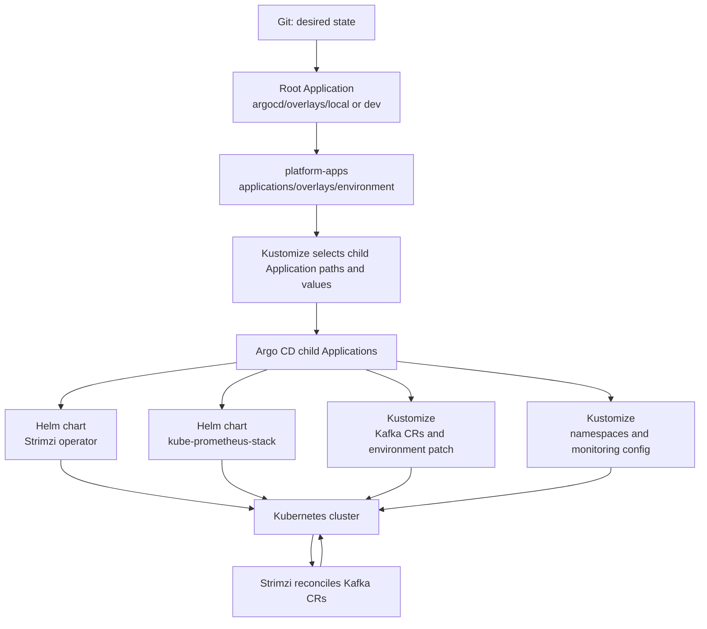

# Helm and Kustomize: team learning guide

This guide explains how Helm and Kustomize are used in this repository, how
to render and inspect the desired Kubernetes resources, and what to consider
before adapting this learning environment for production. It complements
[`ARCHITECTURE.md`](./ARCHITECTURE.md), which documents the broader GitOps
deployment and Kafka design.

The command examples assume you are in the repository root and use Bash (or
Git Bash). They render and inspect manifests unless explicitly noted.

## The short version

- **Helm** packages and renders third-party applications. Here, Argo CD renders
  the Strimzi operator and Prometheus/Grafana Helm charts using checked-in
  values files.
- **Kustomize** customizes Kubernetes YAML without copying whole environments.
  Here, bases hold common resources and overlays select an environment or apply
  a small patch.
- **Argo CD** watches Git, renders Helm/Kustomize sources, compares them with
  the cluster, and reconciles the desired state. A local `helm template` or
  `kubectl kustomize` command is useful for review, but Argo CD remains the
  deployer.

## How they fit together here



The Argo CD Application definitions in `applications/base` are also
Kubernetes YAML. The `applications/overlays/local` and `applications/overlays/dev`
Kustomize overlays patch those Application objects: they choose the actual
Kustomize paths for namespaces/Kafka/monitoring and add environment-specific
Helm values files. For the local environment, the Kafka overlay adds a TLS
NodePort listener; the dev overlay reuses the Kafka base without that patch.

| Concern | This repository's implementation |
|---|---|
| Strimzi operator installation | Strimzi Helm chart `1.3.0`, values in `infrastructure/strimzi/` |
| Monitoring installation | `kube-prometheus-stack` Helm chart `92.17.1`, values in `infrastructure/monitoring/` |
| Kafka and Kafka entities | Kustomize base and environment overlays under `platform/kafka/` |
| Namespace and PodMonitor configuration | Kustomize under `platform/namespaces/` and `platform/monitoring/` |
| Environment selection | Root Application source path plus App-of-Apps Kustomize overlay |

Helm and Kustomize are not competing choices in this design: Helm supplies
versioned upstream applications, and Kustomize organizes and patches the
repository's first-party manifests.

## Helm concepts and repository examples

A Helm **chart** is a package containing templates, default values, and
metadata. A **release** is an installation instance of a chart. A values file
overrides chart defaults; when multiple values files are supplied, later files
override earlier values at the same key.

The Strimzi Application declares its chart version and release name in
`applications/base/strimzi.yaml`. Its `$values` reference points to a second
Git source, where `infrastructure/strimzi/values.yaml` is the baseline. The
environment overlay adds `infrastructure/strimzi/overlays/<environment>/values.yaml`.
Monitoring follows the same multi-source pattern. The chart version is pinned
in the Application; values are kept separately from the upstream chart.

The `helm` command is handy for inspecting and locally rendering a chart.
These commands do not install or upgrade the repository's Argo CD-managed
Applications:

```bash
helm repo add strimzi https://strimzi.io/charts/
helm repo add prometheus-community https://prometheus-community.github.io/helm-charts
helm repo update

# Read chart metadata and defaults.
helm show chart strimzi/strimzi-kafka-operator --version 1.3.0
helm show values strimzi/strimzi-kafka-operator --version 1.3.0

# Render Strimzi with baseline values, then the local environment overrides.
helm template strimzi-cluster-operator strimzi/strimzi-kafka-operator \
  --version 1.3.0 --namespace strimzi-system \
  --values infrastructure/strimzi/values.yaml \
  --values infrastructure/strimzi/overlays/local/values.yaml

# Render monitoring values the same way.
helm template monitoring prometheus-community/kube-prometheus-stack \
  --version 92.17.1 --namespace monitoring \
  --values infrastructure/monitoring/values.yaml \
  --values infrastructure/monitoring/overlays/local/values.yaml
```

The monitoring local values file is currently `{}`; it is still listed in the
overlay to make the per-environment values structure consistent. For dev,
replace `local` with `dev`.

Useful Helm investigation commands:

```bash
# See what a chart contains and its version/dependencies.
helm show chart prometheus-community/kube-prometheus-stack --version 92.17.1
helm show values prometheus-community/kube-prometheus-stack --version 92.17.1

# Search rendered output for a Kubernetes kind, name, or setting.
helm template strimzi-cluster-operator strimzi/strimzi-kafka-operator \
  --version 1.3.0 --namespace strimzi-system \
  --values infrastructure/strimzi/values.yaml \
  --values infrastructure/strimzi/overlays/local/values.yaml |
  grep -n -E 'kind: Deployment|name: strimzi-cluster-operator'
```

### Helm ownership in Argo CD

Argo CD uses Helm to render chart templates, then manages the rendered
Kubernetes objects as an Argo CD Application. In this repository, Helm is the
manifest renderer; do not assume there is a manually operated Helm release to
change with `helm upgrade`. Change the pinned chart version or values in Git,
review the rendered diff, and let Argo CD sync it. Argo CD's embedded Helm
version can differ from the workstation's Helm CLI, so local rendering is a
useful check but not a perfect substitute for Argo CD's renderer.

For upgrades, inspect upstream chart release notes and breaking changes,
confirm compatibility with the Kubernetes version and related operators, and
test against a non-production environment. Strimzi chart/operator upgrades
also need a compatible Kafka version and supported custom-resource APIs.

## Kustomize concepts and repository examples

A Kustomize **base** defines reusable resources. An **overlay** includes a base
and applies environment-specific changes using patches, labels, images, or
generators. The `kustomization.yaml` file declares the resources and
transformations. Kustomize renders plain Kubernetes YAML; it does not install
or manage an upstream chart in this repository.

For example:

- `platform/kafka/base/kustomization.yaml` includes the Kafka cluster,
  KafkaNodePool, KafkaTopic, and KafkaUser resources.
- `platform/kafka/overlays/local/kustomization.yaml` includes that base and
  appends the local TLS NodePort listener to the Kafka resource.
- `platform/kafka/overlays/dev/kustomization.yaml` includes the same base with
  no local external-listener patch.
- `applications/overlays/local/kustomization.yaml` patches child Application
  sources to use local platform paths and adds local Helm values references.

Render each root before committing:

```bash
kubectl kustomize argocd/overlays/local
kubectl kustomize applications/overlays/local
kubectl kustomize platform/namespaces/overlays/local
kubectl kustomize platform/kafka/overlays/local
kubectl kustomize platform/monitoring/overlays/local

# Render the dev counterparts as well when changing shared bases.
kubectl kustomize argocd/overlays/dev
kubectl kustomize applications/overlays/dev
kubectl kustomize platform/namespaces/overlays/dev
kubectl kustomize platform/kafka/overlays/dev
kubectl kustomize platform/monitoring/overlays/dev
```

To narrow the rendered output, pipe it into a YAML-aware tool such as `yq`
(if installed), or inspect it in a file/diff viewer. Pay particular attention
to the final resources after patches, not only the patch text.

`kubectl diff -k <overlay-path>` compares a rendered overlay with the live
cluster and does not apply the changes. It requires a working Kubernetes
context and access to the relevant resources. Avoid `kubectl apply -k` on
resources already owned by Argo CD: that creates a second writer and can cause
drift or confusing ownership. For normal delivery, commit and push changes and
inspect/sync the owning Argo CD Application.

## A safe change-and-review loop

1. **Find the owning source.** Use the Application source path in
   `applications/base/*.yaml` and the selected environment's overlay. Edit the
   Helm values or Kustomize base/overlay that owns the desired state.
2. **Make the smallest change.** Prefer changing values for chart configuration
   and patching a base in an overlay for environment-only behavior. Do not edit
   operator-generated Kafka Deployments, Services, or PVCs directly.
3. **Render.** Run the relevant `kubectl kustomize` command. For Helm, render
   with the same chart version and ordered values files shown in the Argo CD
   Application.
4. **Review consequences.** Compare expected resource count, names, namespaces,
   selectors, ports, storage, security settings, and resource requests/limits.
   Consider deletion/pruning and data impact, not only additions.
5. **Validate in a non-production environment.** Check Argo CD's diff and
   health, then application-level behavior. For Kafka, test client connectivity,
   authentication/authorization as configured, and produce/consume.
6. **Promote through Git.** Merge reviewed changes and use the intended
   environment promotion process. Check sync status and workload health after
   each promotion.

Useful live-state commands:

```bash
kubectl -n argocd get applications
argocd app get platform-apps
argocd app diff local-kafka
argocd app diff strimzi-operator
argocd app diff monitoring

# Monitoring is intentionally not configured for automated sync here.
# An explicit sync changes the cluster; review its diff first.
argocd app sync monitoring

kubectl -n kafka get kafka,kafkanodepool,kafkatopic,kafkauser,pods,pvc
kubectl -n strimzi-system get deployment,pods
kubectl -n monitoring get prometheus,podmonitor,pods
```

Do not sync blindly: root and several child Applications have automated sync,
pruning, and self-healing. A deleted manifest can therefore result in live
resource deletion. Monitoring's child Application has automated sync disabled
in this repo, but its resources still require deliberate review and sync.

## Production readiness: what this lab does not provide

This repository is a learning lab, not a production-ready Kafka blueprint.
Before production adoption, design and test at least the following:

- **Failure domains and Kafka topology:** use separate broker and controller
  pools as appropriate, distribute replicas across nodes/zones, and validate
  quorum and recovery behavior. The current three combined-role pods run on a
  single Minikube node.
- **Storage and recovery:** select durable, performant storage; define capacity,
  growth, retention, backup/restore, and disaster-recovery objectives. Test
  restoration, not merely backup creation. PVC deletion can destroy data.
- **Security:** configure and verify Kafka listener authentication and
  authorization, TLS trust/certificate rotation, Kubernetes RBAC, network
  policies, Pod Security, and external secret management. A KafkaUser CR alone
  does not prove that the listener enforces that authentication mechanism.
- **Resource and availability policy:** right-size requests/limits, replicas,
  disruption budgets, anti-affinity/topology spread, autoscaling boundaries,
  and maintenance procedures using measured workload data.
- **Observability and operations:** configure durable monitoring/alerting,
  alert ownership and response runbooks, log retention, SLOs, capacity alerts,
  and tested upgrade/rollback procedures. The current Prometheus data is
  ephemeral with 24-hour retention; Alertmanager is disabled.
- **GitOps governance:** use a reviewed promotion process, least-privilege
  Argo CD projects and repository credentials, protected branches, policy
  checks, drift/secret controls, and an explicit plan for pruning and
  application deletion.
- **Version and API lifecycle:** pin and document compatible versions, review
  release notes, test CRD/API migrations, and upgrade operators and Kafka in a
  supported order. Do not treat chart rendering as proof that a migration is
  safe.

These are design and validation topics, not a checklist that can be satisfied
by switching `local` to `prod`. There is currently no production overlay in
this repository.

## Official references

- [Helm documentation](https://helm.sh/docs/)
- [Helm chart template guide](https://helm.sh/docs/chart_template_guide/)
- [Kustomize documentation](https://kubectl.docs.kubernetes.io/guides/)
- [Argo CD Helm documentation](https://argo-cd.readthedocs.io/en/stable/user-guide/helm/)
- [Argo CD Kustomize documentation](https://argo-cd.readthedocs.io/en/stable/user-guide/kustomize/)
- [Strimzi documentation](https://strimzi.io/documentation/)
