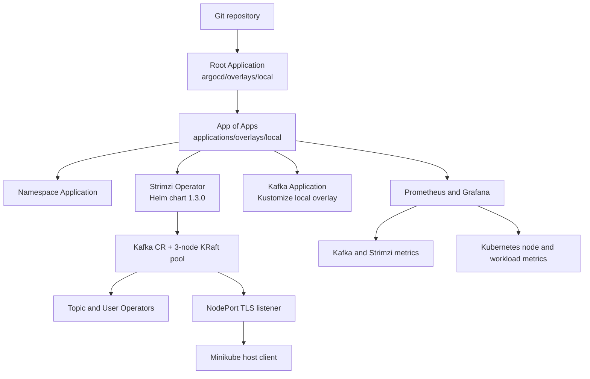

# Strimzi Kafka on Minikube with Argo CD

GitOps-first, single-node Minikube lab for Strimzi Kafka. The manifests pin the verified stable releases current when this repository was generated: Argo CD `v3.5.7` and Strimzi `1.3.0`. Review upstream compatibility and release notes before upgrading.

## Architecture

For the detailed deployment flow and Strimzi/Kafka component design, see
[ARCHITECTURE.md](./ARCHITECTURE.md).



Argo CD owns the namespace, operator, Kafka custom resources, topic, and user. The root Application bootstraps the App-of-Apps. Automated sync, pruning, and self-healing are enabled for the root and platform Applications; the monitoring Application deliberately has automated sync disabled.

## Repository walkthrough

```text
.
├── bootstrap/
│   └── root-application.yaml
├── argocd/
│   ├── base/
│   │   ├── app-of-apps.yaml
│   │   └── kustomization.yaml
│   └── overlays/
│       ├── dev/kustomization.yaml
│       └── local/kustomization.yaml
├── applications/
│   ├── base/
│   │   ├── kafka.yaml
│   │   ├── kustomization.yaml
│   │   ├── monitoring.yaml
│   │   ├── namespaces.yaml
│   │   └── strimzi.yaml
│   └── overlays/
│       ├── dev/kustomization.yaml
│       └── local/kustomization.yaml
├── infrastructure/
│   ├── monitoring/
│   │   ├── values.yaml
│   │   └── overlays/
│   │       ├── dev/values.yaml
│   │       └── local/values.yaml
│   └── strimzi/
│       ├── values.yaml
│       └── overlays/
│           ├── dev/values.yaml
│           └── local/values.yaml
├── platform/
│   ├── kafka/
│   │   ├── base/
│   │   │   ├── kafka-cluster.yaml
│   │   │   ├── kafka-nodepool.yaml
│   │   │   ├── kafka-topic.yaml
│   │   │   ├── kafka-user.yaml
│   │   │   └── kustomization.yaml
│   │   └── overlays/
│   │       ├── dev/kustomization.yaml
│   │       └── local/kustomization.yaml
│   ├── monitoring/
│   │   ├── base/
│   │   │   ├── dashboards/kafka-overview.json
│   │   │   ├── kafka-pod-monitor.yaml
│   │   │   ├── kustomization.yaml
│   │   │   └── strimzi-operator-pod-monitor.yaml
│   │   └── overlays/
│   │       ├── dev/kustomization.yaml
│   │       └── local/kustomization.yaml
│   └── namespaces/
│       ├── base/
│       │   ├── kustomization.yaml
│       │   └── namespaces.yaml
│       └── overlays/
│           ├── dev/kustomization.yaml
│           └── local/kustomization.yaml
└── README.md
```

`applications/base` defines the child Applications; environment-specific Application sets live in `applications/overlays/<environment>`. The Kafka base contains environment-neutral CRs; its `local` overlay adds a TLS NodePort listener. The included `dev` overlays reuse the base resources and omit the Minikube-only external listener. To bootstrap dev, set the root Application's `spec.source.path` in `bootstrap/root-application.yaml` to `argocd/overlays/dev` before applying it. Add `prod` overlays following the same pattern and use production-specific values, secret management, and policies. For production, replace the combined broker/controller pool with dedicated controller and broker pools, external secret management, multiple failure domains, and production storage/networking policies.

The monitoring Application installs the Prometheus Operator stack from the Prometheus Community chart. Prometheus scrapes Kubernetes and node metrics plus Strimzi Kafka and operator metrics; Grafana imports the repository-managed Kafka overview dashboard. Monitoring data uses ephemeral storage with a 24-hour retention period to limit Minikube disk use. Grafana and Prometheus Services remain `ClusterIP`. Node Exporter runs in the exempt `kube-system` namespace because its host filesystem metrics require host paths; the rest of the monitoring stack runs in the baseline-enforced `monitoring` namespace.

## Deployment flow

### Prerequisites

Linux workstation with `git`, `gh`, `kubectl`, `minikube` 1.39+, Helm 4+, Kustomize (or kubectl's Kustomize support), and `argocd` CLI. Authenticate the GitHub CLI first (`gh auth login`). Use a machine with at least 6 CPU cores, 8 GiB RAM, and 25 GiB free disk for this lab.

The Minikube node runs three combined-role Kafka pods on one failure domain. This is intentionally a small lab topology, not production HA. Kafka requests 512 MiB per pod and persistent claims are 5 GiB per broker (15 GiB total). The external listener uses TLS and NodePorts assigned by Kubernetes.

### Prepare Grafana credentials

Grafana's administrator password is deliberately not stored in Git. Before pushing the monitoring Application, create the namespace and a local-only password Secret. The namespace is also declared in Git and will be adopted by Argo CD:

```bash
kubectl create namespace monitoring --dry-run=client -o yaml | kubectl apply -f -
GRAFANA_PASSWORD="$(openssl rand -base64 32)"
kubectl -n monitoring create secret generic grafana-admin \
  --from-literal=admin-user=admin \
  --from-literal=admin-password="${GRAFANA_PASSWORD}" \
  --dry-run=client -o yaml | kubectl apply -f -
unset GRAFANA_PASSWORD
```

Keep the generated password in a password manager. If this installation has already been pushed, create the Secret before Grafana starts; the Grafana pod will become ready after the Secret exists.

### Create and publish the repository

Run these commands from the directory containing the generated files. Set a unique GitHub repository name and organization/user:

```bash
export GITHUB_OWNER="$(gh api user --jq .login)"
export REPO_NAME="strimzi-minikube-gitops"
export REPO_URL="https://github.com/${GITHUB_OWNER}/${REPO_NAME}.git"

git init
git branch -M main
git add .
git commit -m "Add Strimzi Kafka GitOps platform"
gh repo create "${GITHUB_OWNER}/${REPO_NAME}" --private --source=. --remote=origin --push

# Substitute the actual Git remote in all Argo CD Application sources.
git grep -l 'REPO_URL_PLACEHOLDER' -- '*.yaml' '*.yml' |
  xargs -r sed -i "s|REPO_URL_PLACEHOLDER|${REPO_URL}|g"
git add .
git commit -m "Configure GitOps repository URL"
git push -u origin main
```

`main` is used as the tracked branch. If you choose another default branch, update `targetRevision` in the root, App-of-Apps, and child Application manifests before bootstrapping.

### Start Minikube and bootstrap Argo CD

```bash
minikube start \
  --driver=docker \
  --kubernetes-version=v1.37.0 \
  --cpus=6 \
  --memory=8192 \
  --disk-size=40g

kubectl apply -n argocd \
  -f https://raw.githubusercontent.com/argoproj/argo-cd/v3.5.7/manifests/install.yaml
kubectl -n argocd rollout status deployment/argocd-server --timeout=5m

# Apply the sole initial Application; Git manages everything after this point.
kubectl apply -f bootstrap/root-application.yaml
```

This bootstrap creates a **private** GitHub repository, so Argo CD needs read access before it can load the root Application. Create a GitHub fine-grained personal access token scoped to this repository with **Contents: read-only** permission. Register it as an Argo CD repository Secret (do not commit it):

```bash
export GITHUB_USER="$(gh api user --jq .login)"
export REPO_URL="https://github.com/${GITHUB_USER}/strimzi-minikube-gitops.git"
read -rsp "GitHub read-only token: " GITHUB_TOKEN
printf '\n'

kubectl -n argocd create secret generic github-gitops-repo \
  --from-literal=type=git \
  --from-literal=url="${REPO_URL}" \
  --from-literal=username="${GITHUB_USER}" \
  --from-literal=password="${GITHUB_TOKEN}" \
  --dry-run=client -o yaml |
  kubectl apply -f -
kubectl -n argocd label secret github-gitops-repo \
  argocd.argoproj.io/secret-type=repository --overwrite
unset GITHUB_TOKEN

# Refresh the root app to retry Git access after registering credentials.
kubectl -n argocd annotate application root \
  argocd.argoproj.io/refresh=hard --overwrite
```

The URL in the Secret must exactly match `repoURL` in the Applications (including HTTPS and `.git`). Confirm that `${REPO_URL}` is the actual repository and that branch `main` exists. To use a different owner or repository name, update the URL in every Application source and in this command. For public repositories, credentials are unnecessary.

An equivalent CLI bootstrap for an already-installed Argo CD is:

```bash
argocd app create root \
  --repo "${REPO_URL}" \
  --path argocd/overlays/local \
  --revision main \
  --dest-server https://kubernetes.default.svc \
  --dest-namespace argocd \
  --sync-policy automated \
  --auto-prune \
  --self-heal \
  --sync-option CreateNamespace=true
```

Do not run both bootstrap methods with conflicting root Application specs. Prefer `kubectl apply` of the checked-in manifest, so the root app is fully reproducible.

### Optional local render checks

Before pushing changes, validate all Kustomize roots. The Helm chart is rendered by Argo CD's Helm renderer; a local Helm CLI is useful for chart inspection but doesn't control Argo CD's bundled renderer.

```bash
kubectl kustomize argocd/overlays/local
kubectl kustomize applications/overlays/local
kubectl kustomize platform/namespaces/overlays/local
kubectl kustomize platform/kafka/overlays/local
kubectl kustomize platform/monitoring/overlays/local
helm repo add strimzi https://strimzi.io/charts/
helm repo update
helm show chart strimzi/strimzi-kafka-operator --version 1.3.0
helm repo add prometheus-community https://prometheus-community.github.io/helm-charts
helm show chart prometheus-community/kube-prometheus-stack --version 92.17.1
```

## Validation commands

```bash
# Root and child Argo CD Applications
kubectl -n argocd get applications
argocd app get root
argocd app get platform-apps
argocd app get strimzi-operator
argocd app get local-kafka
argocd app get monitoring
argocd app wait root --health --sync --timeout 900
argocd app wait platform-apps --health --sync --timeout 900
argocd app wait strimzi-operator --health --sync --timeout 900
argocd app wait local-kafka --health --sync --timeout 900
argocd app wait redpanda-console --health --sync --timeout 900
argocd app wait monitoring --health --sync --timeout 900

# Strimzi operator and custom resources
kubectl -n strimzi-system get deployment,pods
kubectl -n strimzi-system rollout status deployment/strimzi-cluster-operator --timeout=5m
kubectl get crd kafkas.kafka.strimzi.io kafkanodepools.kafka.strimzi.io kafkatopics.kafka.strimzi.io kafkausers.kafka.strimzi.io

# Kafka cluster, node pool and entity operator
kubectl -n kafka get kafka,kafkanodepool,pods,pvc
kubectl -n kafka wait kafka/local-kafka --for=condition=Ready --timeout=15m
kubectl -n kafka get pods -l strimzi.io/cluster=local-kafka

# Topic and user reconciliation
kubectl -n kafka wait kafkatopic/demo-events --for=condition=Ready --timeout=5m
kubectl -n kafka wait kafkauser/app-user --for=condition=Ready --timeout=5m
kubectl -n kafka wait kafkauser/topic-explorer --for=condition=Ready --timeout=5m
kubectl -n kafka get kafkatopic demo-events
kubectl -n kafka get kafkauser app-user
kubectl -n kafka get secret app-user -o name

# Monitoring stack and Strimzi scrape targets
kubectl -n monitoring get pods,svc,podmonitor
kubectl -n monitoring get prometheus
kubectl -n monitoring get podmonitor strimzi-kafka strimzi-cluster-operator
kubectl -n kube-system get daemonset,pods -l app.kubernetes.io/name=prometheus-node-exporter
kubectl -n monitoring port-forward svc/monitoring-grafana 3000:80

# Inspect the advertised external endpoints
kubectl -n kafka get kafka local-kafka \
  -o jsonpath='{.status.listeners[?(@.name=="external")].bootstrapServers}{"\n"}'
kubectl -n kafka get svc -l strimzi.io/cluster=local-kafka
minikube ip
```

The `KafkaUser` generated Secret contains credentials and must be treated as sensitive. The external listener's bootstrap address comes from the Kafka status; broker NodePorts are also exposed in listener status. On Docker-based Minikube, use the node address returned by the listener status / `minikube ip`. If that address is not routable from the host, use a supported Minikube driver or tunnel/port-forward strategy and preserve the advertised broker addresses.

Open `http://localhost:3000` after starting the Grafana port-forward and sign in as `admin` with the password stored in the `grafana-admin` Secret. The provisioned dashboard is **Strimzi Kafka Overview**. In Prometheus, check **Status → Targets** for Kafka pods in namespace `kafka` and the Strimzi operator in `strimzi-system`.

### Kafka topic explorer

The GitOps setup deploys Redpanda Console as a lightweight, read-only Kafka
topic explorer; it does not deploy Redpanda brokers. A dedicated Strimzi
`KafkaUser` grants the Console access to list topics, inspect topic
configuration, and consume records. Its generated password remains in a
Kubernetes Secret and is not stored in Git.

Check that the explorer and its Kafka user are ready:

```bash
kubectl -n kafka wait kafkauser/topic-explorer --for=condition=Ready --timeout=5m
kubectl -n kafka rollout status deployment/redpanda-console --timeout=5m
kubectl -n kafka port-forward svc/redpanda-console 8080:8080
```

Open `http://localhost:8080` while the port-forward is running. The Service is
ClusterIP-only; use port-forwarding for local access. The Console UI itself
has no login configured, so do not expose it outside the local learning
cluster.

Useful Kafka CLI checks from inside the cluster:

```bash
kubectl -n kafka exec local-kafka-local-0 -c kafka -- \
  bin/kafka-topics.sh --bootstrap-server local-kafka-kafka-bootstrap:9092 --list
```

## Troubleshooting

- **Child Application is OutOfSync or Missing:** inspect `kubectl -n argocd describe application <name>` and `argocd app get <name>`. Confirm each committed `repoURL` and `targetRevision` is correct and readable by Argo CD.
- **Kafka CRD not found:** the Kafka app has retry/backoff configured. Wait for the Strimzi chart to establish CRDs, then inspect `kubectl -n strimzi-system logs deployment/strimzi-cluster-operator` and sync the Kafka app again if needed.
- **Pods pending or evicted:** check `kubectl describe pod -n kafka <pod>` and `kubectl describe node minikube`; increase Minikube RAM/CPU and verify available disk.
- **PVC pending:** inspect `kubectl get storageclass,pvc -A`. Minikube's default storage provisioner must be enabled. Do not delete PVCs unless intentionally discarding the local Kafka data.
- **Kafka not Ready:** inspect Kafka and KafkaNodePool status conditions and operator logs. Ensure all three broker/controller pods have persistent claims and that the Kafka pool's cluster label matches `local-kafka`.
- **Kafka broker is `OOMKilled`:** Strimzi Kafka JVM heap is configured at 512 MiB, so leave additional headroom for native memory and the filesystem page cache. The local node pool requests 768 MiB and limits each broker/controller pod to 1536 MiB; commit and sync the node-pool change rather than editing Strimzi-managed pods directly.
- **Monitoring app degraded:** check `kubectl -n argocd describe application monitoring`, then inspect Prometheus Operator and Grafana pod events. Ensure the `grafana-admin` Secret exists with `admin-user` and `admin-password` keys.
- **Kafka targets missing in Prometheus:** ensure the Kafka CR has `spec.kafka.metricsConfig.type: strimziMetricsReporter`, the `strimzi-kafka` PodMonitor exists in `monitoring`, and Prometheus discovers monitors labeled `release: monitoring`. Inspect Prometheus **Status → Targets** and `kubectl -n kafka get pods --show-labels`.
- **Grafana dashboard missing:** check the `grafana-dashboard-kafka-overview` ConfigMap in `monitoring` has label `grafana_dashboard=1`, and that Grafana's dashboard sidecar is ready.
- **Kafka Application reports `.spec.kafka.resources: field not declared in schema`:** Kafka broker resource requests and limits belong on the `KafkaNodePool` spec, not `Kafka.spec.kafka`. The local node pool manifest sets them; remove the unsupported field from the Kafka resource and let Argo CD resync.
- **NodePort bootstrap connects but brokers do not:** Kafka clients must reach every advertised broker NodePort, not only the bootstrap service. Confirm the node IP and ports are routable from the host; Docker driver networking can require a different Minikube driver or a carefully configured tunnel.
- **Topic/User not Ready:** verify `entity-operator` pods are running and their CR labels point at `local-kafka`; inspect `kubectl -n kafka describe kafkatopic demo-events` and `kubectl -n kafka describe kafkauser app-user`.

## Upgrade process

1. Read the Strimzi release notes and its supported Kubernetes/Kafka version matrix. Upgrade only to a compatible Strimzi chart/operator version.
2. Update the relevant chart `targetRevision` in `applications/base/strimzi.yaml` or `applications/base/monitoring.yaml`, the Strimzi image tag in `infrastructure/strimzi/values.yaml`, and the Kafka `version`/`metadataVersion` in `platform/kafka/base/kafka-cluster.yaml` as required by that release.
3. Check breaking API changes and ensure the new CRDs are applied before CRs that use them. Keep Argo sync retry enabled; stage operator/CR changes in separate commits when a migration requires ordered human review.
4. Render Kustomize roots, review the diff, commit, and push. Argo CD syncs and reports health. Monitor Kafka rolling updates and PVC status.
5. Back up data before any Kafka or storage migration. For this single-node lab, deleting a PVC destroys the corresponding broker's local data and is not a routine upgrade step.

Argo CD's chart renderer is bundled with the Argo CD release, independent of the Helm CLI installed on the workstation. Confirm the bundled renderer supports a chart before upgrading beyond the tested setup.
